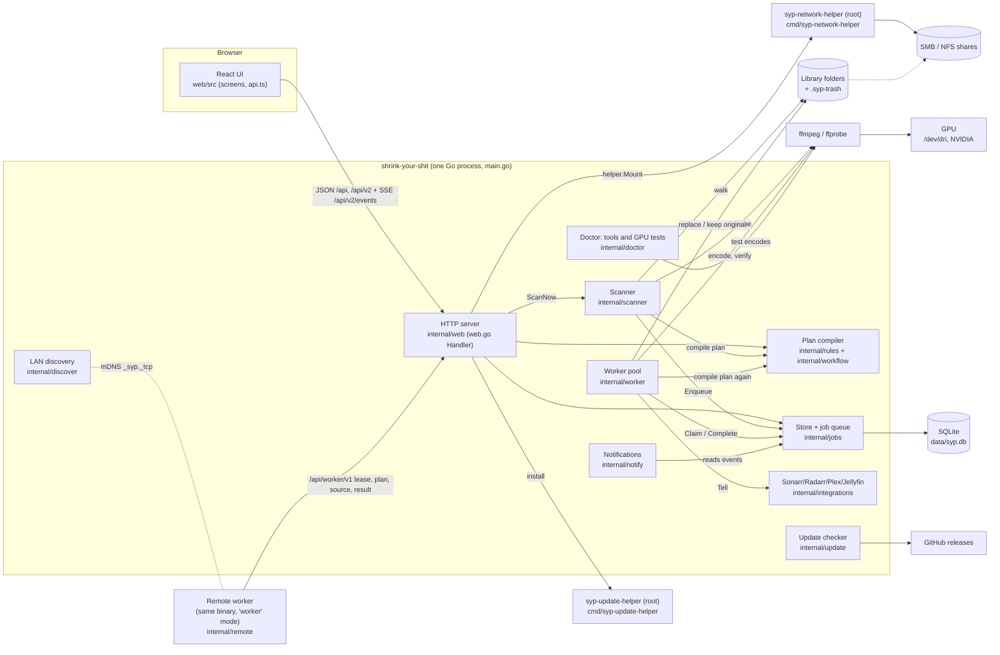
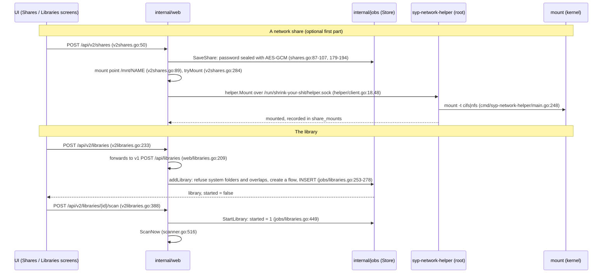
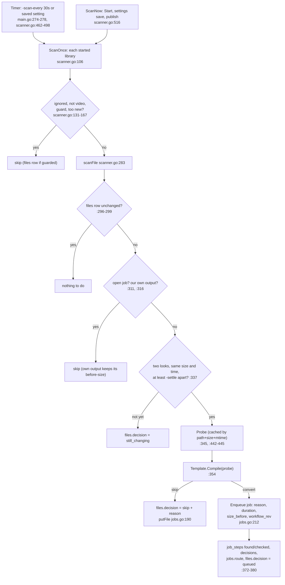
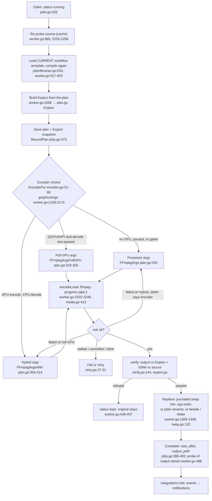
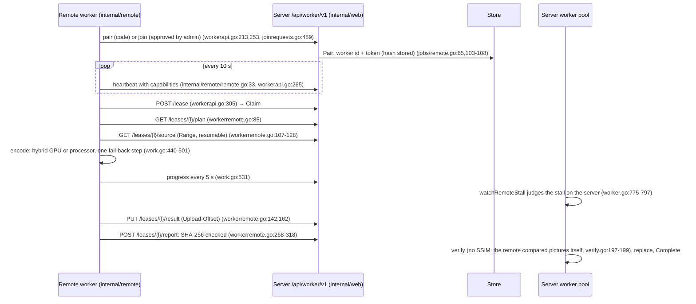
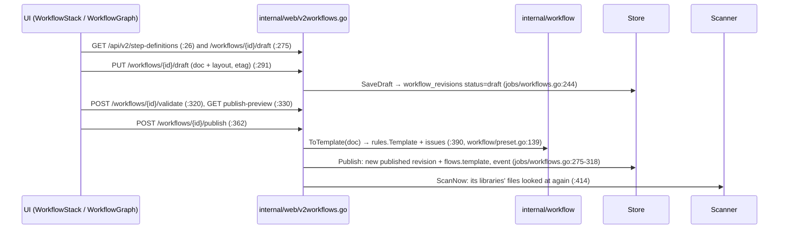
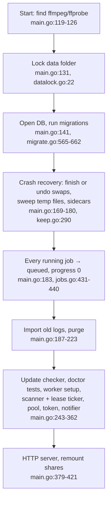
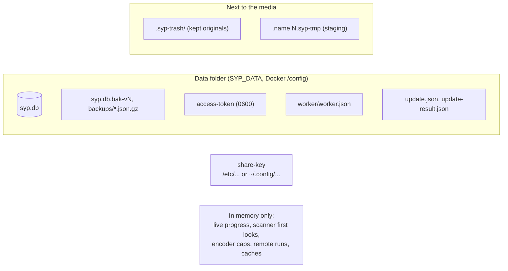

# App map: how Shrink Your Shit fits together

True for: `dev` at commit `294e3d88` (2026-11-20). This is a map, not the territory: every box and
arrow cites a file so it can be checked, and anything not confirmed in the code is marked
**UNVERIFIED**. Line numbers drift; search for the named function if a line has moved.

Companion: `foundation-review.md` in this folder (coming in a separate pull request: why the job pipeline keeps needing fixes, and
what to change). The older [docs/ARCHITECTURE.md](../ARCHITECTURE.md) still describes the app as it was
after PR #4 in places (an embedded plain HTML page, "remote workers would implement `Queue`"); where the
two disagree, this map is the newer reading.

Contents:
1. [The whole app on one page](#1-the-whole-app-on-one-page)
2. [Components](#2-components)
3. [Flow: adding a library or a network share](#3-flow-adding-a-library-or-a-network-share)
4. [Flow: scanning](#4-flow-scanning)
5. [Flow: one job, start to end, per encoder path](#5-flow-one-job-start-to-end-per-encoder-path)
6. [Flow: remote workers](#6-flow-remote-workers)
7. [Flow: editing and publishing a workflow](#7-flow-editing-and-publishing-a-workflow)
8. [Flow: restart, update and restore](#8-flow-restart-update-and-restore)
9. [Where state lives](#9-where-state-lives)
10. [External edges](#10-external-edges)

---

## 1. The whole app on one page

**In plain words.** Everything runs in one Go program (`main.go:49`). The **scanner** walks each started
library's folder on a timer, asks **ffprobe** what each video is, and asks the **plan compiler** whether
it should be converted; if so it puts a **job** in the SQLite queue. The **worker pool** takes jobs from
the queue, works out the plan again, runs **ffmpeg** (on the processor or the graphics card), checks the
new file, and swaps it in, keeping the original in `.syp-trash` if the user asked for that. The **web
server** serves the React UI and its JSON API, and is the only way in for the browser and for **remote
workers** (other machines running the same program in worker mode). Two small **root helpers** do the
things the main program may not: mounting network shares and installing updates.

Citations for the boxes and arrows:

| Box or arrow | Where |
|---|---|
| Boot order of every box | `main.go:119-421` (section 8) |
| Routes, guard, SSE | `internal/web/web.go:28-111`, `internal/web/auth.go:163-201`, `internal/web/v2events.go:32` |
| UI client and live stream | `web/src/api.ts:17-35`, `web/src/live.ts:18` |
| UI embedded in the binary | `internal/web/next/next.go:14-21` (built `dist` folder; git keeps only `.keep`) |
| Scanner timer and ScanNow | `main.go:272-278`, `internal/scanner/scanner.go:462-516` |
| Scanner → probe → compile → enqueue | `internal/scanner/scanner.go:345,354,365` |
| Worker re-probes and recompiles | `internal/worker/worker.go:885,917` |
| ffmpeg arguments | `internal/rules/plan.go:342-443` (`Plan.ffmpegArgs`) |
| Replace / keep original | `internal/worker/worker.go:1309-1458`, `internal/worker/keep.go:120` |
| Doctor encoder tests | `internal/doctor/doctor.go:242` (`hardwareTest`) |
| Notifications | `internal/notify/notify.go:186,204` (polls events every 5 s) |
| Integrations | `internal/integrations/integrations.go:531` (`Service.Tell`) |
| Share mounts | `internal/web/v2shares.go:284-304` → `internal/helper/client.go:48` → `cmd/syp-network-helper/main.go:248` |
| Remote worker API | `internal/web/workerapi.go:213-430`, `internal/web/workerremote.go:85-318` |
| Discovery | `internal/discover/discover.go:21,42,87` |
| Updates | `internal/update/update.go:22,191`, `cmd/syp-update-helper/main.go:80` |

---

## 2. Components

One line each: what it owns. Size is non-test Go lines, rounded.

| Component | Owns | Main entry |
|---|---|---|
| `main.go`, `platform.go`, `token.go`, `doctor.go`, `restore.go`, `workercmd.go` | Flags and env, data folder, boot order, subcommands `token`, `doctor`, `worker`, `update-watch`, `restore` | `main.go:49-62` |
| `cmd/syp-network-helper` | Root helper: mounts SMB/NFS shares for the app over a Unix socket | `cmd/syp-network-helper/main.go:86` |
| `cmd/syp-update-helper` | Root helper: installs a downloaded release and rolls back on a failed health check | `cmd/syp-update-helper/main.go:80` |
| `internal/scanner` | Walking libraries, file guards, the two-look settle rule, probing (with cache), deciding and queueing | `ScanOnce` `scanner.go:106`, `scanFile` `:283` |
| `internal/media` | Running ffprobe/ffmpeg (`Exec`), parsing probe JSON into `Info`/`Stream`, parsing `-progress` | `Probe` `media.go:211`, `TranscodeLines` `media.go:413` |
| `internal/rules` | The **plan**: what to do with one file (video, audio, subtitles, container, output) and the ffmpeg arguments for it; encoder choice; the **expectation** the output is checked against | `Template.Compile`, `Plan.ffmpegArgs` `plan.go:342`, `EncoderFor` `encoder.go:51`, `Plan.Expect` `plan.go:~600` |
| `internal/workflow` | v2 workflows: step definitions, the editor's document (`Doc`), its checks, and turning a `Doc` into a `rules.Template` | `ToTemplate` `preset.go:139`, `PresetOrder` `preset.go:120` |
| `internal/vars` | `{{name}}` variables for workflow fields and the job log | used by `internal/web/v2joblog.go:136` |
| `internal/jobs` | The SQLite store: every table, migrations, the job state machine, leases, swaps journal, backups and restore, totals | `OpenAs`, `Enqueue` `jobs.go:212`, `Claim` `:333`, `transition` `:386-428`, migrations `migrate.go:30-536` |
| `internal/worker` | Running one job: re-plan, choose encoder, encode with fallbacks, stall watchdog, verify, replace, log | `worker.go` (2,259 lines), `verify.go`, `keep.go`, `live.go`, `retry.go` |
| `internal/remote` | The **remote worker's** side: pair/join, heartbeat, lease, download, encode, upload, report | `remote.go`, `work.go:263,440` |
| `internal/web` | HTTP: v1 and v2 JSON API, auth, SSE streams, remote-worker API, embedding the UI | `web.go:28` `Handler` |
| `web/src` | The React UI (Vite + React 19): screens, API wrappers, mock mode | `web/src/screens/*`, `api.ts`, `mock/` |
| `internal/doctor` | Setup and health checks: finds tools, test-encodes on each GPU family, decode tests, folder checks | `Checker.Converter` `internal/doctor/doctor.go:314`, `hardwareTest` `:242` |
| `internal/helper` | Client for the network helper's socket (not related to workers) | `helper.Mount` `client.go:48` |
| `internal/pathmap` | Maps a server path to a remote worker's path for shared-folder mode | `Map` `pathmap.go:55` |
| `internal/discover` | mDNS announce/browse so workers find servers on the LAN | `discover.go:42,87` |
| `internal/notify` | Webhook and Discord notifications from the event feed | `Service.Run` `notify.go:186` |
| `internal/integrations` | Tells Sonarr, Radarr, Plex, Jellyfin about a replaced file | `Service.Tell` `integrations.go:531` |
| `internal/update` | Daily release check, download, install via helper, rollback watcher | `update.Run` `update.go:191`, `RunWatcher` `watch.go:125` |
| `internal/preview` | Read-only dry run of a library with a setting: counts, skip reasons, savings range | `Previewer.Library` `preview.go:136` |
| `internal/sysload` | CPU/memory meter for the Workers page (Linux only); **not** used by the encode path | `Meter.Sample` `sysload.go:39` |
| `Dockerfile`, `docker-entrypoint.sh`, `run-as-syp.sh`, `docker-compose.yml` | The image: ffmpeg and GPU drivers from Debian, root entry that starts the network helper, then drops to uid 1000 with the GPU device groups | `Dockerfile:30-68`, `docker-entrypoint.sh:16-48`, `run-as-syp.sh:7-26` |

---

## 3. Flow: adding a library or a network share

**In plain words.** A share is saved with its password encrypted by a key file kept outside the database
(`internal/jobs/shares.go:45-60`; without that file the stored passwords can't be read). The app can't
mount anything itself, so it asks the root network helper over a local socket, which mounts the share
under `/mnt/<name>`. A library is just a folder (on a share or not) plus the workflow it uses. A new
library starts **not started**: nothing is scanned until the user presses Start, which sets `started`
and wakes the scanner. A watcher checks shares every minute and pauses the libraries of a share that
dropped (`internal/web/shareoffline.go:19-30,90`). Whether that watcher also remounts, or only reports,
is **UNVERIFIED** (`shareoffline.go:114`).

Note: the v2 library route forwards into the v1 handler (`internal/web/v2libraries.go:233` → `internal/web/libraries.go:209`), so
both API versions share one implementation here.

---

## 4. Flow: scanning

**In plain words.** There is no file-system watcher; the scanner polls (`-scan-every`, 30 s by default,
`main.go:80`). A file is only decided after it has looked the same twice, at least `-settle` (15 s,
`main.go:81`) apart, so a file still being copied is not touched. Each file is probed once per size and
modification time (cached in the `probes` table). The library's workflow is compiled into a **plan** for
that file: either a skip with a reason, which is written to `files`, or a job in the queue.

The scan-time plan is **not kept**: only its reason and the probe's duration are copied onto the job.
The worker builds the plan again when it starts the job (section 5). See foundation-review.md, cause 3.

---

## 5. Flow: one job, start to end, per encoder path

**In plain words.** When a worker takes a job it does not reuse the scanner's plan: it probes the file
again (normally a cache hit), loads the workflow **as it is now** and compiles a fresh plan. From that
plan it also writes down what the new file *should* look like (the **Expect**: codec, picture size,
streams, length). Then it picks one of three ways to encode:

- **Processor (CPU):** software encoders (libx265, libx264, libsvtav1, libvpx-vp9; `rules/formats.go:21-25`).
- **Hybrid:** the processor decodes, the graphics card encodes (NVENC, QSV, VAAPI or AMF).
- **Full GPU:** the card decodes, scales and encodes (QSV and VAAPI only), chosen when the doctor's decode
  test for that card passed (`main.go:325`).

All three are built by one function with branches, `Plan.ffmpegArgs` (`plan.go:342-443`). If an encode
fails, the worker steps down a ladder: full GPU → hybrid → processor (`worker.go:1172-1201`), deciding
from ffmpeg's error text (`worker.go:2180-2199`, `jobs/failure_codes.go:37-50`). Three graphics failures
in a row pause that encoder for an hour (`jobs/encoderhealth.go:19-20`).

While ffmpeg runs, only a forward-moving position counts as progress. A stall is 10 minutes without one
(`worker.go:229`), or 1 hour once the position has reached the end, because ffmpeg goes quiet while it
finishes an MP4 (`worker.go:235`, `:728-733`).

After the encode the new file is checked against the Expect and, picture by picture, against the original
(SSIM, `verify.go:442`). If it passes, it is swapped in; if not, the job ends as **kept** and the original
stays. Section 9 lists where the job's facts are stored.

---

## 6. Flow: remote workers

**In plain words.** A remote worker is the same program started in worker mode on another machine. It
pairs with a one-time code or asks to join and waits for approval. It then takes jobs by **lease**
(renewed every 10 s; a lease older than 5 minutes is taken back, `main.go:279-293`), downloads the
original (or reads it through a shared folder mapped by `internal/pathmap`), encodes, uploads the result
and reports. The server checks the upload's hash, verifies it and replaces the original itself.

Remote workers build their ffmpeg arguments with the same `rules.Plan` methods, but the **run loop,
fall-back and 10-bit decision are separate copies** (`internal/remote/work.go:478-518`), and they never
use the full GPU path (`work.go:524`). See foundation-review.md, cause 2.

---

## 7. Flow: editing and publishing a workflow

**In plain words.** The editor works on a **draft** document. Publishing checks it, converts it into the
older `rules.Template` form (the form the scanner and worker actually run), and stores both: the
revision's `doc` (for the editor and history) and `flows.template` (for running). Then every library on
that workflow is scanned again. A converting workflow must keep its video steps in the fixed preset order
(`workflow/preset.go:120`) or it can't run yet. Jobs already queued are not tied to the revision they were
queued under: the worker loads the current template when it starts them (`internal/jobs/libraries.go:533`;
`jobs.workflow_rev` is only read by Convert again and the job log, `jobs/again.go:100,227`).

---

## 8. Flow: restart, update and restore

**In plain words.** On start the app takes a lock so only one copy uses the data folder, upgrades the
database if needed (it keeps raw copies `syp.db.bak-v<N>`, newest 3, `migrate.go:552,694`), and then
repairs whatever a crash left half done: a swap of original and new file is finished or rolled back using
the journal in `originals`, and leftover temp files are removed. Any job that was **running** goes back to
the queue from 0%, because live progress is only in memory. Pause state survives (it is stored in
`workers.enabled`, `internal/jobs/activity.go:282`). Everything else held in memory (section 9) is rebuilt by
re-testing or re-scanning; for example the scanner's first look at each file is forgotten, so files need
two fresh looks.

**Update:** a daily check against GitHub releases (`update/update.go:22,191`). Installing in the app goes
through the root update helper (Linux) or the Windows installer; a watcher rolls back to the previous
binary and the raw database copy if the new one fails its health check (`update/marker.go:181-200`,
`watch.go:125`). In Docker the image is updated from outside (**UNVERIFIED** how `u.method()` decides).

**Backup and restore of the app's data:** gzipped JSON dumps of the whole database (manual, before update,
before migration, before import; automatic ones pruned to 10; `jobs/backup.go:24-35,103-171`). A restore is
refused while a job runs, takes a safety backup first, and replaces every table except the worker ones in
one transaction (`jobs/restore.go:150-204,459`). The CLI `restore` command is different: it brings back a
kept original file (`restore.go:27` at the repo root).

---

## 9. Where state lives

**Database tables** (all in `internal/jobs/migrate.go`, written only through `jobs.Store`):

| Table | Holds | Source of truth for |
|---|---|---|
| `jobs` (:34) | One row per job: status, progress, `size_before`, `size_after`, `output_path`, error, lease, `workflow_rev`; JSON `plan`, `route`, `fallback`, `subtitle_files` | Job status; before/after sizes |
| `files` (:32) | The scanner's last decision per path (size, mtime, codec, decision, reason) | Why a file was skipped |
| `probes` (:84) | ffprobe cache keyed by **path** (+ size, mtime check) | Nothing: a cache |
| `originals` (:89) | Swap journal and trash record (state, delete_on, hashes) | Whether an original is kept, and crash recovery |
| `flows` (:57) | Workflow name and the **template it runs** (JSON) | What a library runs |
| `workflow_revisions` (:242) | Editor documents: drafts and published revisions (JSON `doc`, `layout`) | Workflow history and the editor |
| `libraries` (:62, :513) | Folder, workflow, started, priority, share pause | Libraries |
| `events` (:276) | Event feed, filled by triggers on `jobs` (:286-369) | Live stream, notifications, activity |
| `job_steps`, `job_run_steps`, `job_log_lines`, `job_failures`, `job_run_stats`, `job_run_moves` (:204, :417-507) | Per-job logs and what the replace did | The job log |
| `workers`, `worker_pairings`, `worker_paths`, `join_requests` (:327-454) | Remote workers, their token hash, capabilities, path maps | Remote workers |
| `shares`, `share_mounts` (:428-434) | Shares, sealed password, mount points | Shares |
| `encoder_tests` (:464) | History of doctor encoder tests (written; no non-test reader found, **UNVERIFIED**) | History only |
| `app_meta` (:48) | Key/value: `settings` (one JSON document), `install`, `notifications`, `integrations`, `updateCheck`, `encoderHealth:<worker>`, `intake_paused`, … | Settings |

**Settings** have no file of their own: one JSON value in `app_meta` (`internal/web/settings.go:22-53,71`).
Flags and env vars (`main.go:68-86`, `platform.go:18,82`) set the data folder, address, ffmpeg paths and a
few defaults; a saved `scanEvery` overrides the flag (`main.go:274`).

**Totals** (space freed, waiting, could free) are **not stored**: they are summed from `jobs` and
`originals` by SQL (`jobs/freed.go:41-75`), in three places (`internal/jobs/activity.go:26`, `internal/jobs/libraries.go:574`,
`internal/jobs/overview.go:158`), and cached in memory for up to about a minute (`web/v2overview.go:269,354`).

**In memory only** (lost on restart, rebuilt as shown): live job progress (`worker/live.go:35`, reset to 0),
encoder capabilities (`doctor/doctor.go:113-127`, re-tested at boot), the scanner's first looks
(`scanner.go:68-71`), remote runs by lease (`web/workerremote.go:31`, leases expire), discovered servers
(`discover.go:69-75`), overview, preview, free-space and GPU-load caches.

**Copies of the same fact** that can disagree are listed in foundation-review.md, cause 3.

---

## 10. External edges

| Edge | How | Where |
|---|---|---|
| ffmpeg / ffprobe | Found by flag, env, `PATH`, then next to the binary; Docker uses Debian's ffmpeg | `platform.go:30`, `main.go:83-84,119-126`, `Dockerfile:30-38` |
| GPU | Doctor test-encodes nvenc, qsv, vaapi, amf (and videotoolbox) in 8- and 10-bit; VAAPI device from `/dev/dri/renderD*`; vendor from sysfs; NVIDIA load via `nvidia-smi` | `doctor/doctor.go:72-78,242`, `media/vaapi.go:18`, `doctor/health.go:161`, `web/gpuload.go:64` |
| GPU in Docker | `/dev/dri` passed in (commented out by default in compose); the entry script adds the device groups | `docker-compose.yml`, `run-as-syp.sh:7-26` |
| File system | Library walk, temp files next to the original, `.syp-trash`, renames | `scanner.go:106`, `worker/tempfile.go:37,145`, `worker/keep.go:33` |
| Network shares | Root helper mounts CIFS/NFS; CIFS credentials go to a temporary 0600 file that is deleted after the mount | `cmd/syp-network-helper/main.go:194-262` |
| Browser | React UI, JSON API (v1 ~56 routes, v2 ~90), one SSE stream plus per-job streams, polling on some screens | `web.go:28-111`, `web/src/live.ts:18`, `web/src/screens/Workers.tsx:159` |
| v1 vs v2 API | The UI still calls v1 for sign-in, token, libraries, folder picker, worker list/start, health, Convert again, kept/restore; several v1 groups look unused (**UNVERIFIED**: built paths may be missed) | `web/src/api.ts:27`, `libraryApi.ts:17-207`, `jobsApi.ts:80-101` |
| Auth | Token file created only when listening beyond loopback; no token = open; Bearer header or `syp_session` cookie (HMAC of token, 90 days); sign-in link `/?token=` logged once at boot | `web/auth.go:31-201`, `platform.go:91`, `token.go:211-219`, `main.go:402` |
| Remote workers | mDNS discovery; pairing code or join approval; per-worker bearer token (hashed); TLS or private address required | `discover.go:21`, `workerapi.go:80,180-213` |
| Notifications | Webhook, Discord | `notify/notify.go:454-460,614` |
| Media servers | Sonarr, Radarr, Plex, Jellyfin | `integrations/integrations.go:47-50,531` |
| Updates | GitHub releases API, daily | `update/update.go:22` |
