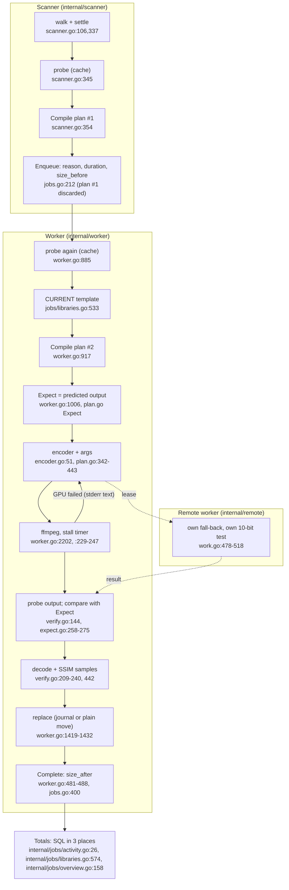
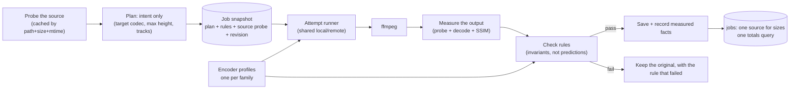

# Foundation review: the job pipeline

True for: `dev` at commit `294e3d88` (2026-11-20). Read-only review: no code was changed. Citations are
repo-relative `file:line` at that commit (lines drift; search for the named function if one moved).
Anything not confirmed in the code is marked **UNVERIFIED**. The [app map](app-map.md) has the whole app;
this document looks only at the path a file takes from scan to saved result.

Contents:
1. [Summary](#1-summary)
2. [The pipeline as it is](#2-the-pipeline-as-it-is)
3. [Root causes, ranked](#3-root-causes-ranked)
4. [Target design](#4-target-design)
5. [Migration plan](#5-migration-plan)
6. [What not to rewrite](#6-what-not-to-rewrite)

---

## 1. Summary

**The question.** Most recent fixes land in the same few files (`internal/worker/worker.go`,
`internal/worker/verify.go`, `internal/rules/plan.go`). Is that bad luck, or is something in the
structure producing the bugs?

**The answer: the structure produces them, through five causes.** None of them needs a rewrite; each has a
small, local fix.

1. **The plan predicts the new file exactly, and the check compares the file with that prediction.** When
   the prediction and what ffmpeg actually did differ by a little, the check cannot tell "a bit different
   from the guess" from "broken", so a good file is refused. A fresh example: QSV rounds a scaled width
   down to 852 while the prediction rounds to the nearest even number, 854, so every 640x360 file scaled
   to 480 lines is refused, and the message says the *original* was 854 wide, which it never was.
2. **What each graphics card family needs is spread over many places**, so one change (for example
   "10-bit SDR needs a 10-bit encoder") has to be made in five to six files, and missing one is a bug.
3. **The same fact is stored in more than one place** (the plan is compiled three times; probes are keyed
   by path only; sizes and totals are worked out several ways), and the copies drift.
4. **Remote workers run a copy of the local run loop** (fall-back steps, stall watch, 10-bit test), so
   every fix there is made twice or only once.
5. **Timers stand in for signals.** A stall is "no progress line for 10 minutes", which forced a 1-hour
   exception for MP4 finishing, and a frame count is duration times frame rate, which is wrong for
   variable-frame-rate files.

**What I recommend:** keep the architecture (one process, SQLite, the scanner/worker split, ffmpeg as a
subprocess, the swap journal) and make five targeted changes, smallest first: check the new file
against rules and record what was measured instead of predicting it; put each encoder family's knowledge
in one place; keep one plan snapshot per job and key probes by file version; share one run loop between
local and remote workers; judge liveness by output written. Section 5 sizes them; the first two remove
the largest share of recent bugs.

**How sure:** the causes rest on code I read (cited) and on 62 fix commits since 2026-11-13 that touch the
pipeline packages, which I sorted by hand. The sorting is a judgment (several commits fit two causes), so
read the counts as a ranking, not a measurement.

---

## 2. The pipeline as it is

**In plain words.** The scanner probes a file and compiles a plan to decide whether to queue it, but keeps
only a few fields from that plan. The worker later probes again and compiles a second plan from the
workflow *as it is then*. From that plan it builds the **Expect**: the exact codec, picture size, bit depth,
stream list and length the new file should have. It chooses an encoder and runs ffmpeg, stepping down from
full GPU to hybrid to processor when ffmpeg's error text looks like a card problem. Afterwards it probes
the new file and compares it field by field with the Expect, then decodes samples and compares pictures
with the original (SSIM). If everything passes, the new file replaces the original. Totals are not
stored; they are summed from the job rows when a screen asks.

A remote worker gets plan #2 from the server, but makes its own encoder decision and fall-back, and
skips nothing the server then repeats except the picture comparison, which it does itself.

---

## 3. Root causes, ranked

Ranked by the number of fix commits each cause produced (62 fix commits from 2026-11-13 to 2026-11-20
touching `internal/{worker,rules,remote,media,scanner}` or the job parts of `internal/jobs` and
`internal/web`; sorted by hand, overlaps allowed). For scale: of 621 non-merge commits in that week, 184
(30%) are fixes; most of the rest of the fixes are UI, install, shares and updater work outside this
pipeline.

| # | Cause | Fix commits | Examples |
|---|---|---|---|
| 1 | The check compares against a prediction, and can't tell "different" from "broken" | ~21 | job 48 (854 vs 852), 10-bit gates, audio length, damage tolerance, 24 fps playback |
| 2 | Encoder knowledge is scattered | ~14 | fall-back ladder, HDR GPU choice, VA-API device, fall-back counting |
| 3 | State is copied and the copies drift | ~12 | stale track statistics, converted files' records, workflow revision stamps, probe cache |
| 4 | Local and remote run loops are copies | ~9 | lease through finish, late remote report, remote 10-bit test |
| 5 | Timers stand in for signals | ~6 | MP4 finishing stall, sample gap, stall warning |

### Cause 1: the plan predicts the output, and the check compares against the prediction

**What happens.** `Plan.Expect` (`internal/rules/plan.go:~600-730`) writes down the exact output: the
codec, the picture size (computed by `ScaledWidth`, `plan.go:1059-1065`), the bit depth (copied from the
source, `internal/rules/expect.go:98`), the stream list and the length. `compareStream`
(`expect.go:258-275`) then requires an exact match. The prediction is a second implementation of what
ffmpeg and the encoder will do, so every encoder detail must be modelled twice, and any gap refuses a good
file.

**Evidence: job 48 (found on a test server, 2026-11-20).**
- `ScaledWidth` rounds to the *nearest* even width: 640x360 → 480 lines gives **854**
  (`plan.go:1059-1065`).
- QSV's full-GPU filter rounds *down*: `scale_qsv=w=trunc(H*a/2)*2` gives **852**
  (`plan.go:460-465`). That filter came from commit 0def124b ("QSV full-GPU scale takes an expression
  width (w=-2 is refused)"), which did not change the prediction.
- `expect.go:269` refuses the file. Its message (`expect.go:262`) reads "the picture size is 854x480 in
  the original but 852x480 in the new file", but 854x480 is the *prediction*: the original is 640x360.
  The words point the reader at the wrong cause.

**Other bugs from the same cause:**
- 10-bit decisions: the expected depth is always the source's (`expect.go:98`), so every encoder that
  can't keep 10 bits needs a gate before the encode, or the check refuses the result: 5e683db3,
  e1e433a9, d1955418 (#498, #507).
- The job log named the *predicted* depth, not the one the encoder produced: a24894e7.
- `DefaultExpect` hard-codes `"hevc"` (`expect.go:101`), and `Expect` sets `"hevc"` before the chosen
  format overrides it (`plan.go:618`, `:650-660`).
- Check false alarms on good files, each fixed by widening a tolerance or adding an exception: 075256c8
  (24 fps + AAC), 406198e0, efe55779, 6266fc6d, e24e6fe2 → f3a676bf (3 pictures, then 1%), f7b23610,
  52ba74ac, 727b2a18, a1a0adb6 (audio length against the original track only), 26b44723.
- Projected sizes: 5147d06a, fcd01ab9.

**Related check defects (same area, found while reading):**
- When the picture check passes, the stored score is the *last* sample's, not the lowest:
  `w.check` is overwritten on every sample (`internal/worker/verify.go:491`).
- Copied video and remote jobs get no SSIM on the server (`verify.go:194-199`), by design.
- There is no size check, by a user decision (`verify.go:192-193`); bigger files are handled in
  `keep.go` (fcd01ab9). Not a defect, listed so nobody re-adds one by accident.

**Structural fix.** Split the check into two kinds:
- **Rules the new file must meet** (invariants): it plays; the main video is the target codec; height ≤
  the target height; the shape (aspect ratio) is within a small tolerance; dimensions are even; the bit
  depth is one the encoder that *ran* can produce; streams the plan keeps are present; length within
  tolerance.
- **Facts measured from the new file** (its probe), stored and shown in the log and UI, never compared
  with a prediction.

The plan then states intent ("at most 480 lines, HEVC, keep English audio"), not exact numbers, and a
new encoder or filter can't break the check by rounding differently. Messages compare "the original"
with the original and "the rule" with the rule.

### Cause 2: encoder knowledge is scattered

**What happens.** What a card family can do, and the arguments it needs, is decided in many places:
- the arguments: one long branch on family and full/hybrid in `Plan.ffmpegArgs`
  (`internal/rules/plan.go:342-443`), with the 10-bit block written twice (`:395-399`, `:401-408`);
- the scale filter per family: `gpuScale` (`plan.go:460-471`);
- which encoder may run: `EncoderFor` (`internal/rules/encoder.go:51-80`), plus `graphicsArgs`
  (`internal/worker/worker.go:2159-2173`);
- the doctor's test commands copy the same arguments (`internal/doctor/doctor.go:421-474`);
- nv12 vs p010 is chosen in the plan and again in the doctor (`internal/doctor/doctor.go:462-467`);
- "is this a 10-bit job" is answered in five places: `plan.go:166`, `plan.go:336` (`EncodeTenBit`),
  `internal/worker/live.go:127`, `internal/rules/bitrate.go:164`, `expect.go:98`, and differently on remote
  workers (`internal/remote/work.go:513-518`);
- whether a failure was the card's: substrings of ffmpeg's error text (`worker.go:2180-2199`,
  `internal/jobs/failure_codes.go:37-50`).

**Bugs from this cause:** 86aab6a2 and ddd0659a (the full-GPU ladder), a7187734 (HDR: card or processor),
38048495 (counting a fall-back), 0c2c3d75 (staged file on fall-back), 32fcd26a and 2c49df83 (which render
node), 7e45603a and 0def124b (full-GPU arguments), d66543b6, 1e3a61e5, ee9e07f8, 6a5af92f, 37f4a30d
(naming the encoder and why it wasn't used), and the 10-bit set under cause 1. PR #498 alone touched six
files for one rule.

**Structural fix.** One **encoder profile** per family (processor, NVENC, QSV, VAAPI, AMF) in
`internal/rules`, holding: what it can encode and at which depths, its decode and scale filters, pixel
formats, quality arguments, how it rounds a scaled width, and how to recognise its own failures. The plan,
the doctor's tests, the check's rules and the job log all ask the profile. Adding a family, or changing a
rule like 10-bit, becomes one edit.

### Cause 3: state is copied, and the copies drift

**What happens.**
- **The plan is compiled up to three times**: by the scanner (`internal/scanner/scanner.go:354`), the
  worker (`worker.go:917`) and the preview (`internal/preview/preview.go:233`). The scanner's plan is
  discarded after it queues the job.
- **The worker uses the workflow as it is now** (`TemplateFor`, `internal/jobs/libraries.go:533`), not the
  revision the job was queued under. `jobs.workflow_rev` is re-stamped to the current revision on restart
  (`internal/jobs/jobs.go:435`) and on Convert again (`internal/jobs/again.go:163`), so it records the
  revision that *ran*, mostly; it is read only by Convert again and the log (`internal/jobs/again.go:100,227`).
- **Probes are keyed by path.** After a replace, the new file's probe is stored under the same path as the
  original's (`worker.go:486-488`), and `LatestProbe` returns the newest row for a path whatever its size
  and time (`jobs.go:503-508`). This is intended for the Files view, but a reader that wants the
  *original's* facts can get the output's.
- **Sizes**: `size_before` is taken at scan time (`scanner.go:365`) and never updated; the swap records
  `original_bytes` separately (`internal/worker/keep.go:151`); `size_after` becomes 0 if the final file
  can't be stat'ed (`worker.go:481-484`), which silently drops the job out of the totals.
- **Totals** are summed by the same SQL in three places (`internal/jobs/activity.go:26`, `internal/jobs/libraries.go:574`,
  `internal/jobs/overview.go:158`) and cached for up to about a minute (`internal/web/v2overview.go:269,354`).
- **Bulk state changes skip the state machine**: `RequeueRunning` (`jobs.go:431-440`), Convert again
  (`internal/jobs/again.go:163`) and others update `status` directly instead of through `transition`
  (`jobs.go:291`).

**Bugs from this cause:** bec80900 and ba702fad (MKV track statistics copied onto re-encoded streams),
eda8fce9, a81ea49e, 37b12950, c3168239 (which conversion and which workflow revision a record keeps),
854fd357, 21777980 (recognising our own output), 1268864a, 1a6a6361 (freed bytes), 7fe872cd (worker and
scanner probed separately until #502).

**Structural fix.**
- One **job snapshot**: the worker's plan, the Expect (or, after cause 1, the rules), the source probe and
  the workflow revision, written once (`RecordPlan`, `jobs.go:373`, already stores most of this) and read
  by everything after: log, UI, totals, Convert again.
- **Probes keyed by (path, size, mtime)** for all readers; the Files view asks for "the current file".
- `size_after` from the measured output; a failed stat fails the step instead of writing 0.
- **One totals query** used by all three screens.
- All status changes through `transition`, including the bulk ones.

### Cause 4: local and remote run loops are copies

**What happens.** The remote worker builds its arguments with the same `rules.Plan` methods, but the loop
around them is a second copy:
- fall-back: `worker.go:1172-1201` locally, `internal/remote/work.go:478-495` remotely, where it has one
  step and never uses the full GPU path (`work.go:524`);
- stall watch: `watchStall` (`worker.go:745-770`) and `watchRemoteStall` (`worker.go:775-797`), with the
  server judging remote stalls in `internal/worker/remotejob.go:65-105`;
- the 10-bit test: `live.go:127` locally vs `work.go:513-518` remotely;
- truncate and re-run on fall-back: `worker.go:1180` and `work.go:484`.
- Whether a remote worker respects a paused encoder (`EncoderPaused`) is **UNVERIFIED**.

**Bugs from this cause:** 8cb43a15, 480b82f6, 04e85ea1, d962d032, ea324e45 (leases and late reports),
9af86913, 56a86fbb (remote tests), 75fe85b0 (a test that exists only to cover the remote copy of the
10-bit rule), c2653180.

**Structural fix.** One **attempt runner** (choose encoder → build arguments → run → classify failure →
step down) used by both. The local pool and the remote client differ only in how they get the source and
deliver the result.

### Cause 5: timers stand in for signals

**What happens.**
- Progress counts only `out_time_us` lines from `-progress` (`internal/media/media.go:413-459`).
- A stall is 10 minutes without forward progress (`worker.go:229`). Because ffmpeg prints no progress while
  it rewrites an MP4 for fast start, a second rule allows 1 hour once the position is within 2 seconds of
  the end (`worker.go:235-239`, `:728-733`; 55c41c83, 950e20be, 68fda339). Whether ffmpeg prints anything
  at all during that rewrite (for example `total_size`) is **UNVERIFIED**.
- The frame count is the duration times the frame rate and is called exact (`verify.go:724-728`); it is
  wrong for variable-frame-rate files, which aren't detected.
- Bitrate ladders and quality steps are fixed tables described as untuned (`internal/rules/bitrate.go:20-80`,
  `internal/rules/flow.go:64-79`).

**Bugs from this cause:** 55c41c83, 950e20be, 68fda339 (MP4 finishing), 26b44723 (sample gap),
0fe750d7 (stall warning), 56a86fbb.

**Structural fix.** Judge liveness by evidence the process is working: the process is alive and the temp
output file is still growing or being written (size and mtime), plus `total_size` from `-progress`. Keep a
long timer only as a last resort. Count frames from the stream (`nb_frames`, or a packet count, which
`CountVideoPackets` already does) instead of multiplying.

### Outside the pipeline (noted, not reviewed)

Install, Docker, network shares and the updater account for about 47 fix commits, the largest group after
the UI. They are a different structure (root helpers, mounts, the platform) and not part of this review.

### Low risk, noted

**UNVERIFIED, inferred:** with 0 keep-days the replace is a plain move with no journal
(`worker.go:1419-1432`). A crash after that move and before `Complete` requeues the job
(`jobs.go:431-440`) at a path that now holds the new file; the worker would most likely skip it as
already converted.

---

## 4. Target design

**One contract: plan → encode → measure → verify.**
- The **plan** says what should happen and why. It does not predict exact output numbers.
- The **job snapshot** is written once when the worker starts: the plan, the rules the result must meet, the
  source probe and the workflow revision. Everything later reads it.
- The **attempt runner** picks an encoder from the profiles, runs it, and steps down on a card failure the
  profile recognises. Local and remote workers share it.
- **Measure** the new file: probe, decode, picture comparison. These are facts and are stored.
- **Verify** = the rules applied to the measured facts. A failed rule names the rule and the measured value
  ("852x480: the shape is within 0.3% of the original's").

**One encoder abstraction.** A profile per family: capabilities (codecs, depths, full GPU or not), filters,
pixel formats, quality arguments, rounding, failure patterns. Used by the plan, the doctor, the rules and
the log.

**One source of truth for stats.** Sizes come from the measured files and live on the job row; totals come
from one query; probes are per file version.

---

## 5. Migration plan

Small slices, each its own pull request, each shippable alone. Sizes: S ≈ under 150 changed lines,
M ≈ 150-500, L ≈ over 500.

| # | Slice | Size | Fixes | Depends on |
|---|---|---|---|---|
| 1 | Make the prediction match QSV (or compare width with a ±2 tolerance) and fix the "in the original" wording | S | job 48 now | none |
| 2 | Store the lowest SSIM score, not the last; fail the step when the output can't be stat'ed instead of writing `size_after` 0 | S | cause 1, 3 | none |
| 3 | Check rules: shape tolerance, even dimensions, max height, depth the ran encoder can produce, codec from the plan. Keep Expect for stream lists and length for now | M | cause 1 | none |
| 4 | Record the measured output (probe) on the job and show it in the log instead of the predicted values | S | cause 1 (a24894e7 class) | 3 |
| 5 | Encoder profiles: move `gpuScale`, pixel formats, 10-bit rules and failure patterns into one profile per family; the plan and doctor read it | L (split per family) | cause 2 | 3 helps |
| 6 | One "is this a 10-bit job" function, used by plan, live, bitrate, rules and the remote worker | S | cause 2, 4 | can come before 5 |
| 7 | Probe readers by (path, size, mtime); the Files view asks for the current file | S | cause 3 | none |
| 8 | One totals query for the three screens | S-M | cause 3 | none |
| 9 | The worker compiles from the revision stored on the job, or records the revision it ran and shows it | S | cause 3 | decision: user |
| 10 | Bulk status changes through `transition` | S | cause 3 | none |
| 11 | Shared attempt runner for local and remote | M-L | cause 4 | 5, 6 |
| 12 | Liveness from output growth + `total_size`; timer only as a last resort | M | cause 5 | measure first: what ffmpeg prints during the MP4 rewrite |
| 13 | Frame count from the stream, VFR detected | S | cause 5 | none |

Slices 1, 2, 6, 7 and 10 are each small and independent. Slices 3 and 5 remove the largest share of the
recent bugs. Slice 9 changes behaviour users can notice (a queued job runs with the settings it was queued
with), so it needs the user's choice.

---

## 6. What not to rewrite

- **One Go process with SQLite in WAL mode** (`internal/jobs/jobs.go:121-152`). Simple to install, back up
  and restore, and not the source of these bugs.
- **ffmpeg and ffprobe as subprocesses** (`internal/media`). The bugs come from what the app predicts about
  ffmpeg, not from calling it.
- **The scanner/worker split, the two-look settle rule and the probe cache** (`internal/scanner`). They
  work; only the discarded plan (cause 3) needs attention.
- **The swap journal and crash recovery** (`internal/worker/keep.go:120-320`, `RecoverSwaps`). It is the
  part that protects people's files and it has few fixes.
- **The job state machine and leases** (`internal/jobs/jobs.go:28-45,291`). Sound; only the bulk
  updates that bypass it need to go through it.
- **The v2 workflow editor and `ToTemplate`** (`internal/workflow`). The editor is not part of the encode
  path; the template it produces is what the pipeline reads, and that interface can stay.
- **The UI** (`web/src`). Most UI fixes are product and wording changes, not structure.
- **The picture comparison itself** (SSIM samples, `verify.go:442`). The measurement is right; what goes
  wrong is comparing other facts with predictions.

A rewrite would throw away the parts above that work and would recreate the five causes unless the
contract in section 4 is adopted anyway. The slices get there one pull request at a time.
